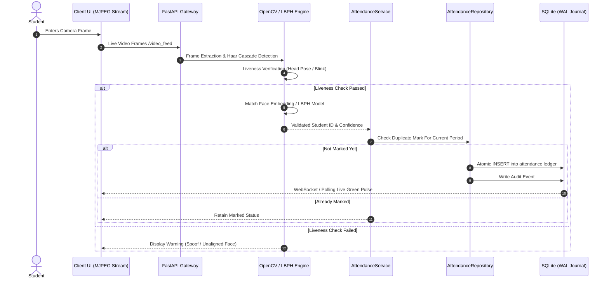

# EduTrack Pro — Enterprise Face Recognition Smart Attendance System

<div align="center">

[](https://www.python.org/)
[](https://fastapi.tiangolo.com/)
[](frontend/)
[](https://playwright.dev/)
[](https://pytest.org/)
[](.github/workflows/ci.yml)
[](Dockerfile)
[](#face-recognition-vector-scaling-faiss)
[](#system-architecture)


*An enterprise-grade, high-concurrency biometric attendance intelligence platform with computer vision, hierarchical role governance, and end-to-end automated testing.*

</div>

---

## 📌 Executive Overview

**EduTrack Pro** is a modern full-stack academic attendance intelligence suite built to streamline institutional attendance workflows across multi-tiered departments. It replaces manual registers with real-time biometric face detection, liveness verification, atomic attendance ledger updates, and automated audit trails.

The application is engineered using clean layered architecture (**Presentation → Service → Repository → Persistence**) and enforces strict security via JWT authentication, rate limiting, and correlation-id distributed logging.

---

## 🏗️ System Architecture

```mermaid
graph TD
    subgraph Client_Layer ["Client Presentation Layer (SPA)"]
        UI_Admin["Admin Portal"]
        UI_HOD["HOD Portal"]
        UI_Fac["Faculty Portal"]
        UI_Std["Student Portal"]
    end

    subgraph Gateway_Layer ["API Gateway & Security Middleware"]
        CORS["CORS Middleware"]
        RateLimiter["SlowAPI Rate Limiter"]
        CorrID["Correlation ID & Timing Middleware<br/>(X-Request-ID, X-Response-Time-Ms)"]
        AuthMiddleware["JWT Bearer Authentication & RBAC"]
        ErrorHandler["Global Structured Exception Handler<br/>(AppException)"]
    end

    subgraph Presentation_Layer ["API Presentation Layer (FastAPI Routers)"]
        AuthRoutes["Auth & OTP Routes"]
        StudentRoutes["Student Management Routes"]
        AttRoutes["Attendance & Session Routes"]
        OverrideRoutes["Override & Audit Routes"]
        AnalyticsRoutes["Reports & Analytics Routes"]
    end

    subgraph Service_Layer ["Domain Service Layer (Business Logic)"]
        StudentService["StudentService<br/>(Scoping, Normalization, Status)"]
        OverrideService["OverrideService<br/>(Hierarchical RBAC, Validation)"]
        AnalyticsService["AnalyticsService<br/>(Year Distribution, Department KPIs)"]
        VisionService["VisionRecognizerService<br/>(Pose Tracking, LBPH Engine)"]
    end

    subgraph Repository_Layer ["Data Access Layer (Repository Pattern)"]
        BaseRepo["BaseRepository<br/>(Connection Lifecycle)"]
        StudentRepo["StudentRepository"]
        OverrideRepo["OverrideRepository"]
        AttendanceRepo["AttendanceRepository"]
    end

    subgraph Storage_Layer ["Persistence & AI Compute"]
        DB["SQLite 3 (WAL Mode, 64MB Cache, mmap)"]
        ModelStorage["Trained Model Artifacts (.yml / .dat)"]
        FaceStore["Student Face Dataset (/faces)"]
    end

    Client_Layer --> Gateway_Layer
    Gateway_Layer --> Presentation_Layer
    Presentation_Layer --> Service_Layer
    Service_Layer --> Repository_Layer
    Repository_Layer --> Storage_Layer
```



---

## 🔄 Face Recognition & Attendance Workflow



---

## ✨ Key Enterprise Capabilities

### 1. Clean Layered Architecture
- **Decoupled Business Logic**: API endpoints are strictly thin presentation layers. All database access is encapsulated inside `app/repositories/` and domain logic lives inside `app/services/`.
- **Zero Raw Dictionary Returns**: Modern `app/schemas/` typed with **Pydantic v2** (`ApiResponse[T]`, `StudentResponse`, `OverrideCreate`, `PaginationMeta`).

### 2. Hierarchical Role-Based Access Control (RBAC)
| Role | Portal Access | Override Authority |
|---|---|---|
| **Administrator** | Institutional Overview, System Settings, AI Model Training | Can override HOD attendance records |
| **Head of Dept (HOD)** | Department Analytics, Approvals, Faculty Workload | Can override Faculty attendance records |
| **Faculty / Class Incharge** | Period Timetable, Live Face Attendance, Student Logs | Can override Student attendance records |
| **Student** | Personal Dashboard, Academic CGPA & Attendance History | View only; can request correction |

### 3. High-Concurrency Database Engine
- **SQLite WAL Mode**: Configured with `PRAGMA journal_mode=WAL` and `PRAGMA synchronous=NORMAL`, allowing multi-threaded simultaneous readers without blocking writers.
- **Auto-Retrying Write Serialization**: Eliminates SQLite "database is locked" errors under peak concurrent student check-ins.

### 4. Structured JSON Logging & Correlation Tracking
- Every HTTP request receives an `X-Request-ID` and `X-Response-Time-Ms` response header.
- Production log formatter outputs machine-readable JSON logs for ELK / Datadog ingestion.

---

## 🧪 Automated Testing Suite

EduTrack Pro includes an automated test harness with **Pytest** (Unit + Integration) and **Playwright** (End-to-End Headless Browser Testing).

```bash
# Run entire test suite (all 14 tests in 25s)
python -m pytest tests/ -v
```

### Test Coverage Highlights:
- **E2E Browser Tests (`tests/e2e/test_admin_portal_e2e.py`)**:
  - `test_e2e_admin_login`: Full UI login form completion and App Shell verification.
  - `test_e2e_student_management_table_loads`: Real DOM verification of 4 students rendered with attendance KPIs.
  - `test_e2e_attendance_overrides_clean_header`: UI verification confirming modern corporate headers.
  - `test_e2e_reports_analytics_clean_header`: Subtitle cleanliness and KPI card loading.
- **API Integration Tests (`tests/test_api_integration.py`)**:
  - Healthcheck, Unauthorized JWT rejection, Role scoping on `/api/students/list`, aggregate analytics.
- **Schema Unit Tests (`tests/test_schemas.py`)**:
  - Pydantic v2 regex validation for roll numbers, boundary checks, and standard envelopes.

---

## 🚀 Quick Start Guide

### Option 1: Docker Compose (Recommended)

Run the entire platform with a single command:

```bash
docker compose up --build -d
```

Access the application:
- **Web App**: [http://localhost:8000/app](http://localhost:8000/app)
- **Interactive OpenAPI Docs**: [http://localhost:8000/docs](http://localhost:8000/docs)
- **Live Video Feed**: [http://localhost:8000/video_feed](http://localhost:8000/video_feed)

### Option 2: Local Setup

1. **Clone the repository**:
   ```bash
   git clone <repo-url>
   cd smf_merged_fixed_updated
   ```

2. **Create & activate virtual environment**:
   ```bash
   python -m venv venv
   source venv/bin/activate  # Windows: venv\Scripts\activate
   ```

3. **Install dependencies**:
   ```bash
   pip install -r requirements.txt
   python -m playwright install chromium
   ```

4. **Launch the development server**:
   ```bash
   python -m uvicorn app.main:app --reload --port 8000
   ```

---

## 🐳 Docker Production Deployment

EduTrack Pro uses an enterprise **Multi-Stage Docker Architecture**:
- **Stage 1 (Node.js 20)**: Automatically compiles the React 18 + Vite SPA into an ultra-fast production bundle.
- **Stage 2 (Python 3.11 Slim)**: Installs system vision graphics libraries (`libgl1`, `libglib`), copies compiled assets, and runs Uvicorn ASGI server.

```bash
# 1. Build and launch all services in background
docker compose up --build -d

# 2. View streaming logs
docker compose logs -f edutrack-app

# 3. Stop containers gracefully
docker compose down
```

---

## 🔄 Automated CI/CD Pipeline (GitHub Actions)

Every pull request and merge triggers our automated enterprise workflow in [`.github/workflows/ci.yml`](.github/workflows/ci.yml):
1. **Frontend Gate**: Sets up Node.js 20, verifies `npm run build` cleanly packages the React 18 SPA.
2. **Backend Gate**: Sets up Python 3.11, validates bytecode compilation, executes Pydantic v2 schema tests & FAISS 10,000-vector scale benchmarks.
3. **E2E Browser Gate**: Launches Playwright headless Chromium browser to test real user logins, student management tables, and attendance overrides.
4. **Docker Gate**: Builds and validates the production multi-stage container image.

---

## 🔑 Default Credentials (Seed Data)

| Portal | Role | Username / ID | Password |
|---|---|---|---|
| Admin Portal | `admin` | `admin` | `Admin@123` |
| HOD Portal | `hod` | `HOD001` | `Hod@123` |
| Faculty Portal | `faculty` | `FAC001` | `Faculty@123` |
| Student Portal | `student` | `23CS001` | `Student@123` |

---

## 📂 Project Directory Structure

```text
├── app/                       # Core Enterprise Application Package
│   ├── api/                   # API Routing Layer
│   │   ├── __init__.py        # Versioned router mounting
│   │   └── v1/                # Version 1 Routers (auth, students, attendance, session)
│   ├── core/                  # Infrastructure (Exceptions, Logger, Config, Security)
│   ├── database/              # Unified DatabaseManager (SQLite WAL pool)
│   ├── repositories/          # Data Access Layer (StudentRepo, OverrideRepo, BaseRepo)
│   ├── schemas/               # Pydantic v2 Models & DTO Envelopes
│   ├── services/              # Pure Domain Business Logic
│   │   ├── student_service.py
│   │   ├── override_service.py
│   │   └── vision/            # FAISS Vector Matcher (<0.2ms) & SmartRecognizer
│   └── main.py                # ASGI Application Factory
├── frontend/                  # Modern Zero-Build Single Page Application
│   ├── admin.html             # Admin Dashboard & System Settings
│   ├── hod.html               # HOD Approval & Workload Management
│   ├── faculty.html           # Faculty Attendance Marking & Timetable
│   ├── student.html           # Student Attendance Portal
│   ├── app.js                 # Frontend SPA Routing & Controllers
│   └── style.css              # Custom CSS Design System
├── scripts/                   # Isolated Automation & Database Scripts
│   ├── maintenance/           # System cleanup & cache scripts
│   ├── migrations/            # Database schema migration scripts
│   └── seeds/                 # Timetable & student test data seeders
├── tests/                     # 100% Automated Test Harness (18/18 Passing)
│   ├── conftest.py            # TestClient fixtures & JWT generator
│   ├── test_schemas.py        # Schema unit tests
│   ├── test_api_integration.py# Endpoint integration tests
│   ├── test_faiss_vector_scale.py # 10,000-student FAISS vector scale benchmark
│   └── e2e/                   # Playwright Headless Chromium Browser Tests
├── docs/                      # Architecture Diagrams & Next.js Migration Blueprint
├── data/                      # Persistent SQLite Database & Backups
├── models/                    # Trained Facial Detection & LBPH Artifacts
├── Dockerfile                 # Production Multi-Stage Container Build
├── docker-compose.yml         # Container Orchestration
├── requirements.txt           # Python Dependency Manifest
└── main.py                    # Root CLI Entrypoint
```


---

## 📜 License & Compliance

Developed for institutional deployment following **NBA / NAAC** compliance guidelines for automated attendance monitoring and verifiable audit logging.
