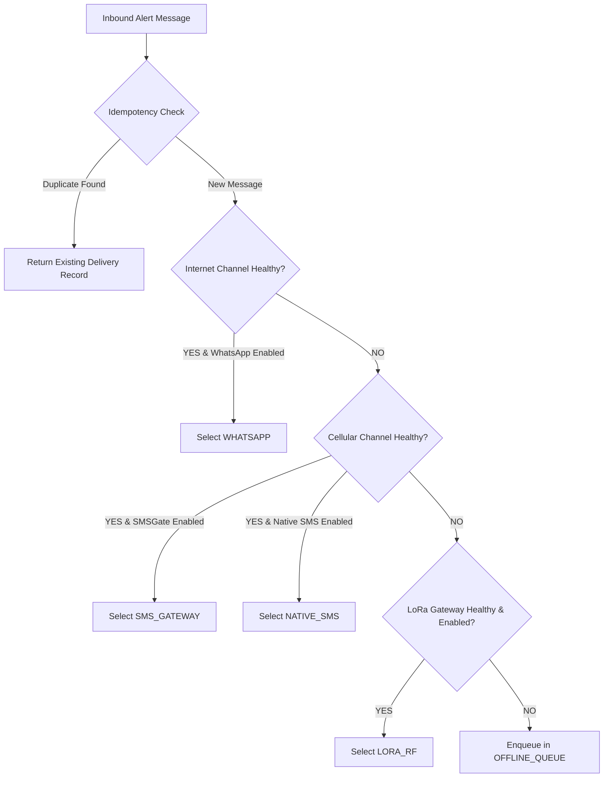

# RIDGEWATCH — Multi-Channel Emergency Communication Architecture
**Document Version:** 1.0.0  
**Date:** September 2026  
**Status:** Approved Architectural Specification (Phases 3, 4, 16)

---

## 1. Architectural Principles & Overview

The RidgeWatch Multi-Channel Emergency Communication subsystem provides disaster-resilient, deterministic, multi-bearer failover routing across heterogeneous networks. 

### Core Architectural Principles
1. **Isolated & Additive:** Resides entirely within the decoupled package `backend/communication/`. Never modifies or imports internal business logic from `fusion_engine.py`, `wearable_gateway.py`, or `rescue_dispatch.py`.
2. **Backward Compatible & Non-Breaking:** Protected by the feature flag `COMMUNICATION_FAILOVER_ENABLED=false` (default). When disabled, existing notification paths execute identically.
3. **Deterministic Failover Hierarchy:** Evaluates real-time channel health and routes alerts through the most capable available bearer:
   - **Tier 1 (Internet):** Twilio/Cloud WhatsApp & Webhooks
   - **Tier 2 (Cellular):** SMSGate Local Server / Native Android SMS
   - **Tier 3 (Offline RF):** Sub-GHz LoRa Mesh / Relay Gateway
   - **Tier 4 (Disconnected):** Delay-Tolerant Local SQLite Store-and-Forward Queue
4. **Strict Idempotency & Deduplication:** Guarantees that duplicate alerts or cross-channel retries never produce duplicate missions or rescuer confusion.
5. **Truthful Delivery Ledger:** Maintains a persistent SQLite ledger (`communication_delivery`) capturing granular states (`QUEUED`, `SENDING`, `SENT`, `DELIVERED`, `ACKNOWLEDGED`, `RETRYING`, `FAILED`, `EXPIRED`).

---

## 2. System Architecture & ASCII Data Flow

```
                         RIDGEWATCH RESCUE PLATFORM
                                      │
                 ┌────────────────────┴────────────────────┐
                 ▼                                         ▼
       Automated Detection Alert                  Commander Mission Action
        (alert_dispatch.py)                      (notification_dispatch.py)
                 │                                         │
                 └────────────────────┬────────────────────┘
                                      │
                                      ▼
                        [COMMUNICATION ROUTER]
                 (backend/communication/communication_router.py)
                                      │
                         ┌────────────┴────────────┐
                         ▼                         ▼
             [Channel Health Monitor]    [Deduplication & Idempotency]
             (channel_health.py)         (delivery_tracker.py)
                         │                         │
                         └────────────┬────────────┘
                                      │
                      Deterministic Channel Selection
                                      │
       ┌──────────────────────────────┼──────────────────────────────┐
       │                              │                              │
       ▼                              ▼                              ▼
 [INTERNET TIER]               [CELLULAR TIER]                [OFFLINE RF TIER]
 WhatsAppAdapter              SMSGatewayAdapter                  LoRaAdapter
 (Twilio/REST Webhook)       NativeSMSAdapter               (Sub-GHz Gateway)
       │                              │                              │
       ▼                              ▼                              ▼
 Internet Available?            Cellular Active?              LoRa Gateway Active?
   ├─ YES ──> [Send]              ├─ YES ──> [Send]              ├─ YES ──> [Broadcast]
   └─ NO ───┐                     └─ NO ───┐                     └─ NO ───┐
            │                              │                              │
            └──────────────────────────────┼──────────────────────────────┘
                                           │ (All channels unavailable)
                                           ▼
                                [LOCAL MESSAGE QUEUE]
                               (message_queue.py - DTN)
                                 Status: OFFLINE_QUEUED
                                           │
                                           ▼
                             [RETRY & ACKNOWLEDGEMENT]
                                 (retry_manager.py)
                                 Backoff: 5s, 15s, 30s
                                           │
                                           ▼
                                [DELIVERY LEDGER DB]
                            (communication_delivery table)
                                           │
                                           ▼
                               [NOTIFICATION / API UI]
                            (frontend/notification.html)
```

---

## 3. Package Structure: `backend/communication/`

The new module is structured according to Clean Architecture and Dependency Injection principles:

```
backend/communication/
├── __init__.py                  # Package exports and singleton factory
├── models.py                    # Domain models, Enums, and Data Transfer Objects
├── config.py                    # Feature flags, timeouts, and backoff settings
├── channel_health.py            # Real-time channel probing and circuit breakers
├── message_queue.py             # Delay-tolerant priority message queue (DTN)
├── delivery_tracker.py          # Idempotency engine and delivery ledger persistence
├── retry_manager.py             # Exponential backoff retry scheduler and ACK processor
├── communication_router.py      # Authoritative routing and failover orchestrator
└── adapters/
    ├── __init__.py              # Adapter registry and base interface
    ├── base.py                  # BaseCommunicationAdapter abstract base class
    ├── whatsapp_adapter.py      # Internet WhatsApp/Webhook adapter
    ├── sms_gateway_adapter.py   # Cellular SMSGate Android Local Server adapter
    ├── native_sms_adapter.py    # Native Android SMS bridge adapter
    └── lora_adapter.py          # Sub-GHz LoRa RF frame adapter (with simulator)
```

---

## 4. Message Model & Identifier Specification

Every communication message is assigned a globally unique, collision-free, human-readable Message ID formatted as:

$$\text{Message ID} = \text{RW-YYYYMMDD-}[A\text{-}Z0\text{-}9]{8}$$

*Example:* `RW-20260914-A8F3C19B`

### Message Schema (`backend/communication/models.py`)

```python
@dataclass
class EmergencyMessage:
    message_id: str                      # Globally unique ID: RW-YYYYMMDD-XXXXXXXX
    alert_id: Optional[str]              # Parent alert identifier (e.g. ALT-CMD-001)
    recipient: str                       # E.164 phone number, Team ID, or "BROADCAST"
    recipient_masked: str                # Privacy-masked recipient string (+91 80988****66)
    priority: MessagePriority            # CRITICAL | HIGH | MEDIUM | LOW
    channel: ChannelType                 # WHATSAPP | SMS_GATEWAY | NATIVE_SMS | LORA | OFFLINE_QUEUE
    payload: str                         # Human-readable message text
    compact_payload: Optional[str]       # Compact binary/ASCII frame for LoRa (<64 bytes)
    status: DeliveryStatus               # QUEUED | SENDING | SENT | DELIVERED | ACKNOWLEDGED | RETRYING | FAILED | EXPIRED
    idempotency_key: str                 # SHA-256 hash of (recipient:alert_id:payload)
    retry_count: int = 0                 # Number of retry attempts executed
    max_retries: int = 3                 # Maximum allowed retries before permanent fail/offline queue
    created_at: str                      # ISO 8601 UTC creation timestamp
    expires_at: str                      # ISO 8601 UTC expiration timestamp (TTL)
    dispatched_at: Optional[str] = None  # Timestamp when adapter accepted transmission
    delivered_at: Optional[str] = None   # Timestamp when delivery confirmation was received
    acknowledged_at: Optional[str] = None# Timestamp when rescuer ACK/ACCEPT was received
    provider_message_id: Optional[str] = None # External gateway ID (e.g. SMSGate ID, Twilio SID)
    last_error: Optional[str] = None     # Error message if last attempt failed
```

---

## 5. Delivery Ledger Database Schema

The subsystem stores all delivery states in a dedicated, isolated SQLite table: `communication_delivery`.

```sql
CREATE TABLE IF NOT EXISTS communication_delivery (
    id                     INTEGER PRIMARY KEY AUTOINCREMENT,
    message_id             TEXT UNIQUE NOT NULL,
    alert_id               TEXT,
    channel                TEXT NOT NULL,
    recipient              TEXT NOT NULL,
    recipient_masked       TEXT NOT NULL,
    priority               TEXT NOT NULL DEFAULT 'HIGH',
    status                 TEXT NOT NULL DEFAULT 'QUEUED',
    retry_count            INTEGER NOT NULL DEFAULT 0,
    max_retries            INTEGER NOT NULL DEFAULT 3,
    provider_message_id    TEXT,
    idempotency_key        TEXT NOT NULL,
    error                  TEXT,
    payload                TEXT NOT NULL,
    compact_payload        TEXT,
    created_at             TEXT NOT NULL,
    updated_at             TEXT NOT NULL,
    dispatched_at          TEXT,
    delivered_at           TEXT,
    acknowledged_at        TEXT,
    expires_at             TEXT NOT NULL
);

CREATE INDEX IF NOT EXISTS idx_comm_delivery_msg_id ON communication_delivery(message_id);
CREATE INDEX IF NOT EXISTS idx_comm_delivery_status ON communication_delivery(status);
CREATE INDEX IF NOT EXISTS idx_comm_delivery_alert ON communication_delivery(alert_id);
CREATE INDEX IF NOT EXISTS idx_comm_delivery_idem ON communication_delivery(idempotency_key);
```

---

## 6. Deterministic Channel Selection Logic

The router evaluates channel availability in strict sequential priority:



### Routing Rules Matrix
1. **Rule 1 (Internet Available):** If `ChannelHealth.internet_available == True` and `WHATSAPP_ENABLED == True`, use WhatsApp.
2. **Rule 2 (Cellular Available):** If Internet is down but `ChannelHealth.cellular_available == True`, use `SMSGateAdapter` (or `NativeSMSAdapter` if configured).
3. **Rule 3 (Offline LoRa Available):** If Internet and Cellular are down, but `LORA_ENABLED == True` and a LoRa Gateway is online, use `LoRaAdapter`.
4. **Rule 4 (Total Blackout):** If all physical bearers are down, queue message locally with status `OFFLINE_QUEUED`.
5. **Priority Rule:** `CRITICAL` priority messages are placed at the front of the queue and processed before `HIGH`, `MEDIUM`, or `LOW` messages.

---

## 7. LoRa Protocol & Compact Frame Specification

Due to Sub-GHz bandwidth and duty-cycle regulations (1% limit in EU/India), LoRa transmissions must strictly avoid verbose JSON payloads.

### Compact ASCII Frame Format
```
RW|<MSG_ID>|<PRIORITY>|<ALERT_ID>|<LAT>|<LON>|<SPS>|<CHECKSUM>
```

- **Example Alert Packet:**  
  `RW|M-A8F3|CRIT|ALT-01|32.37392|77.24915|94.5|C4`  
  *Length: 47 bytes (Time-on-Air < 110ms at SF8, 125kHz bandwidth)*

- **Compact Rescuer ACK Packet:**  
  `RW|ACK|M-A8F3|ALPHA-01|OK|E2`  
  *Length: 28 bytes*

---

## 8. Retry Schedule & Exponential Backoff

When an adapter returns `status: FAILED` or times out, the `RetryManager` schedules retries according to a truncated exponential backoff formula with jitter:

$$t_{\text{backoff}} = \text{base\_delay} \times 2^{(\text{attempt} - 1)} + \text{jitter}$$

### Configured Retry Matrix
| Attempt | Delay Before Attempt | Max Timeout | Action on Failure |
|---|---|---|---|
| **Attempt 1** | Immediate (0s) | 5.0s | Schedule Retry 1 |
| **Attempt 2 (Retry 1)** | 5 seconds ($\pm 1.0\text{s}$) | 5.0s | Schedule Retry 2 |
| **Attempt 3 (Retry 2)** | 15 seconds ($\pm 2.0\text{s}$) | 5.0s | Schedule Retry 3 |
| **Attempt 4 (Retry 3)** | 30 seconds ($\pm 3.0\text{s}$) | 5.0s | Fail over to next bearer or set `FAILED` / `OFFLINE_QUEUED` |

*Safety Guard:* Retries unconditionally terminate after 3 retries or if `expires_at` is exceeded.

---

## 9. Bulk 90-Recipient Queue & Rate Limiting

To prevent crashing SMSGate Android local servers or saturating LoRa channels during mass disaster alerts (e.g. 90 staff recipients):
1. **Asynchronous Dispatcher:** Main API / alert generation threads enqueue messages instantaneously without blocking HTTP requests.
2. **Worker Rate Limiting:** Outbound worker rate-limits dispatch to **5 messages/second** for SMSGate, and **1 message/3 seconds** for LoRa.
3. **Fault Isolation:** Failure of recipient 14 does not block or cancel delivery to recipients 15 through 90.

---

## 10. Conclusion

This architecture establishes a fault-tolerant, isolated multi-channel emergency communication system fully aligned with IEEE disaster networking principles.
