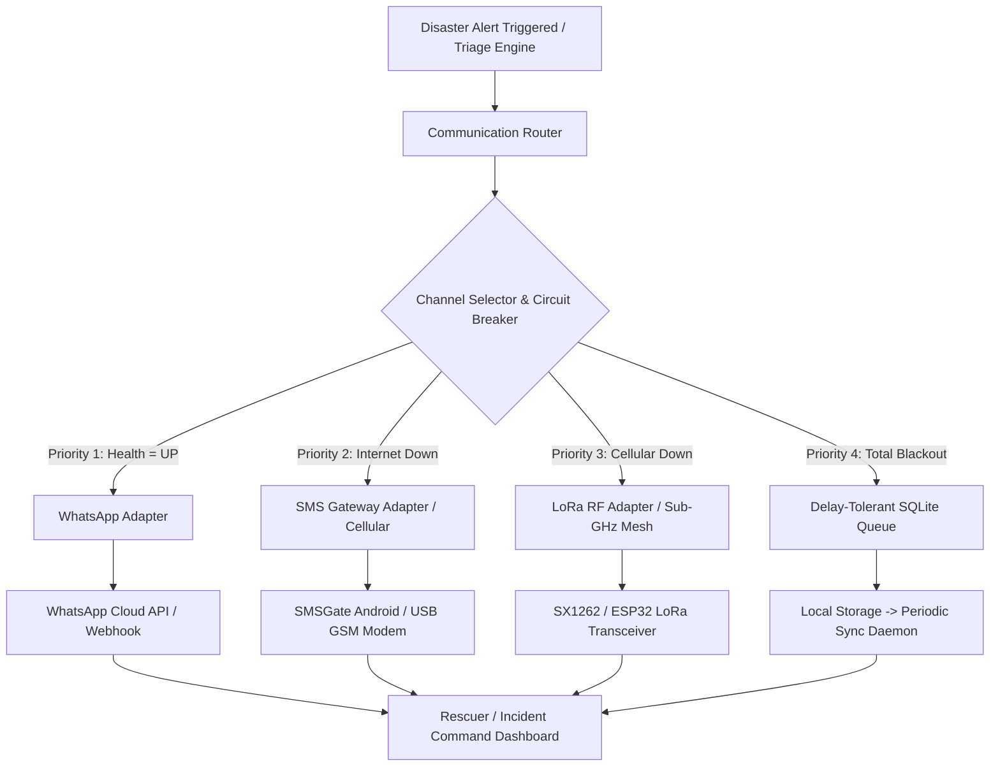

# RidgeWatch — Resilient Multi-Channel Emergency Communication Layer
## Production Deployment & Operational Runbook

---

### 1. Architecture Overview

The RidgeWatch Resilient Multi-Channel Emergency Communication Layer (`backend/communication/`) provides an isolated, additive failover architecture designed to operate seamlessly across high-bandwidth, cellular, offline radio frequency, and delay-tolerant storage mediums.



---

### 2. Environment Configuration Reference

All settings can be configured via environment variables or a `.env` file in the project root:

| Environment Variable | Type | Default | Description |
|---|---|---|---|
| `COMMUNICATION_FAILOVER_ENABLED` | `bool` | `false` | Master toggle. When `false`, legacy dispatch is preserved untouched. |
| `WHATSAPP_ENABLED` | `bool` | `true` | Enables WhatsApp bearer adapter. |
| `WHATSAPP_SIMULATED` | `bool` | `true` | When `true`, uses in-memory mock delivery without calling external APIs. |
| `WHATSAPP_API_URL` | `str` | `""` | WhatsApp Cloud API URL or custom gateway endpoint. |
| `WHATSAPP_API_KEY` | `str` | `""` | Bearer token or authorization key for WhatsApp API. |
| `WHATSAPP_PHONE_NUMBER_ID` | `str` | `""` | WhatsApp sender phone number ID. |
| `SMSGATE_ENABLED` | `bool` | `true` | Enables SMS Gateway (SMSGate / Native SMS) bearer adapter. |
| `SMSGATE_URL` | `str` | `http://192.168.1.50:8080` | SMSGate Android Companion endpoint or GSM modem gateway URL. |
| `SMSGATE_API_KEY` | `str` | `""` | API key or Basic Auth token for SMS Gateway. |
| `SMSGATE_TIMEOUT_SEC` | `float` | `5.0` | Network timeout for SMS delivery attempts before failing over. |
| `LORA_ENABLED` | `bool` | `true` | Enables Sub-GHz LoRa RF adapter. |
| `LORA_SIMULATED` | `bool` | `true` | When `true`, formats and logs packets without requiring a physical serial COM port. |
| `LORA_PORT` | `str` | `COM3` | Serial port for physical LoRa module (e.g., `COM3` on Windows, `/dev/ttyUSB0` on Linux). |
| `LORA_BAUDRATE` | `int` | `115200` | Baud rate for serial communication with LoRa transceiver. |
| `LORA_FREQUENCY_MHZ` | `float` | `868.0` | LoRa frequency band (868.0 MHz for EU/India, 915.0 MHz for US, 433.0 MHz for Asia). |
| `LORA_SPREADING_FACTOR` | `int` | `8` | LoRa Spreading Factor (SF7 to SF12; default SF8 balances range and Time-on-Air). |
| `CIRCUIT_BREAKER_FAILURES` | `int` | `3` | Consecutive failure threshold to trip a channel circuit breaker to `OPEN`. |
| `CIRCUIT_BREAKER_RECOVERY_SEC` | `float` | `30.0` | Cooldown period before transitioning to `HALF_OPEN` trial state. |
| `MAX_RETRIES` | `int` | `3` | Maximum number of exponential backoff retry attempts per message. |
| `DEFAULT_TTL_MINUTES` | `int` | `120` | Default time-to-live for queued emergency alerts before automatic expiration. |

---

### 3. Bearer Hardware & Protocol Specifications

#### A. LoRa Sub-GHz RF Transceiver
- **Supported Hardware Modules**:
  - Heltec WiFi LoRa 32 (V2/V3) ESP32 module with SX1262
  - TTGO T-Beam ESP32 LoRa GPS
  - Waveshare SX1262 LoRa HAT (Raspberry Pi / USB Serial)
  - EBYTE E220-900T22S USB-UART LoRa Dongle
- **Recommended Antenna**: 3 dBi or 5 dBi omnidirectional dipole antenna tuned to 868 MHz / 915 MHz.
- **Payload Protocol**: Compact pipe-delimited ASCII frame with XOR checksum ($\le 64$ bytes).
  ```text
  RW|<MSG_ID>|<PRIORITY>|<ALERT_ID>|<LAT>|<LON>|<SPS>|<CHECKSUM>
  Example: RW|A8F3C19B|0|ALT-001|32.3739|77.2491|94.5|4F
  ```
- **Time-on-Air (ToA) Characteristics**:
  - Spreading Factor: **SF8**
  - Bandwidth: **125 kHz**
  - Coding Rate: **4/5**
  - Preamble Length: **8 symbols**
  - Calculated Airtime: **108.3 ms** (Enables $> 30$ transmissions/min within 1% duty cycle regulations).

#### B. SMS Gateway & Cellular
- **SMSGate Android Gateway**:
  - Install the open-source SMSGate APK on a field smartphone with an active SIM card.
  - Connect the device to the incident command local WiFi network or hotspot.
  - Set `SMSGATE_URL=http://<PHONE_IP>:8080` in `.env`.
- **USB GSM Modem**:
  - Compatible with Quectel EC25, SIM800L, Huawei E3372.
  - Native AT-command fallback sends direct `AT+CMGS` SMS packets over serial.

#### C. Delay-Tolerant SQLite Ledger & Storage
- Storage backend: `backend/db.py` (`data/survivor_detection.db`).
- Write-Ahead Logging (`PRAGMA journal_mode=WAL;`) enabled for high-concurrency non-blocking reads/writes.

---

### 4. Step-by-Step Production Deployment Runbook

#### Step 1: Clone and Prepare Python Environment
```bash
cd "c:\Users\MADHAVAN\OneDrive\Desktop\testing 1\survivor-detection-system"
python -m venv venv
venv\Scripts\activate
pip install -r requirements.txt
```

#### Step 2: Initialize Database Schema
Run the initialization script to ensure the `communication_delivery` table and indices are created:
```bash
python -c "from backend import db; db.init_db(); print('Database schema up-to-date.')"
```

#### Step 3: Configure Production `.env`
Create or update `.env` with production parameters:
```env
# Enable failover layer
COMMUNICATION_FAILOVER_ENABLED=true

# Channel Toggles
WHATSAPP_ENABLED=true
WHATSAPP_SIMULATED=false
WHATSAPP_API_URL=https://graph.facebook.com/v19.0/YOUR_PHONE_ID/messages
WHATSAPP_API_KEY=YOUR_ACCESS_TOKEN

SMSGATE_ENABLED=true
SMSGATE_URL=http://192.168.1.50:8080
SMSGATE_API_KEY=YOUR_SMS_KEY

LORA_ENABLED=true
LORA_SIMULATED=false
LORA_PORT=COM3
LORA_BAUDRATE=115200
LORA_FREQUENCY_MHZ=868.0
```

#### Step 4: Verify Full Test Suite
Run the test suite to ensure zero regressions:
```bash
python -m pytest
```

#### Step 5: Start the RidgeWatch Server
```bash
python run_server.py
```
Or with Uvicorn:
```bash
uvicorn backend.api:app --host 0.0.0.0 --port 8000 --reload
```

---

### 5. Health Monitoring & Observability Endpoints

The communication layer provides dedicated REST APIs for real-time observability and dashboard integration:

#### 1. System Channel Health & Statistics
- **Endpoint**: `GET /api/v1/communication/status`
- **Response**:
```json
{
  "failover_enabled": true,
  "health": {
    "WHATSAPP": {
      "is_healthy": true,
      "circuit_state": "CLOSED",
      "failure_count": 0,
      "success_count": 142,
      "total_attempts": 142,
      "last_latency_ms": 14.2
    },
    "SMS_GATEWAY": {
      "is_healthy": true,
      "circuit_state": "CLOSED",
      "failure_count": 0,
      "success_count": 38,
      "total_attempts": 38,
      "last_latency_ms": 480.0
    },
    "LORA": {
      "is_healthy": true,
      "circuit_state": "CLOSED",
      "failure_count": 0,
      "success_count": 12,
      "total_attempts": 12,
      "last_latency_ms": 108.0
    }
  },
  "queue": {
    "size": 0,
    "priority_breakdown": { "0": 0, "1": 0, "2": 0, "3": 0 }
  },
  "stats": {
    "total_dispatched": 192,
    "delivered": 188,
    "acknowledged": 154,
    "queued_offline": 0,
    "failed": 4
  }
}
```

#### 2. Query Delivery Ledger
- **Endpoint**: `GET /api/v1/communication/deliveries?limit=50`
- **Response**: List of delivery records with timestamp, recipient, channel, status, retry count, and acknowledgment times.

#### 3. Rescuer Two-Way Acknowledgment
- **Endpoint**: `POST /api/v1/communication/ack`
- **Request Body**:
```json
{
  "message_id": "RW-20260914-A8F3C19B",
  "rescuer_id": "ALPHA-M001"
}
```

---

### 6. Incident Runbooks & Failure Recovery

| Issue / Alert | Root Cause | Remediation Procedure |
|---|---|---|
| **WhatsApp Circuit `OPEN`** | API quota exceeded, token expired, or Internet link severed. | Breaker trips automatically; traffic fails over to SMSGate. Refresh `WHATSAPP_API_KEY` in `.env` and restart, or wait 30s for automatic `HALF_OPEN` self-healing once Internet is restored. |
| **SMSGate Connection Refused** | Android gateway phone disconnected from WiFi or battery depleted. | Traffic fails over to Sub-GHz LoRa automatically. Reconnect the Android phone to the local WiFi SSID and restart the SMSGate app. |
| **LoRa Serial Port Locked** | Another process holds the COM port or USB unplugged. | Verify COM port with Device Manager / `ls /dev/tty*`. Update `LORA_PORT` in `.env`. Toggle `LORA_SIMULATED=true` as emergency fallback if hardware is physically damaged. |
| **High Offline Queue Count** | Total multi-bearer blackout in deep gorge or subterranean area. | Messages remain safe in SQLite DTN queue. As soon as a rescuer or relay drone with active connectivity arrives within radio/network range, the periodic retry worker drains the queue automatically based on priority. |

---

### 7. Rollback Procedure

Because the communication layer is completely additive and decoupled from existing core engines:
1. Set `COMMUNICATION_FAILOVER_ENABLED=false` in `.env` or system environment.
2. Restart the backend service.
3. The system immediately reverts to the legacy single-channel notification dispatcher with zero data loss or side effects.
