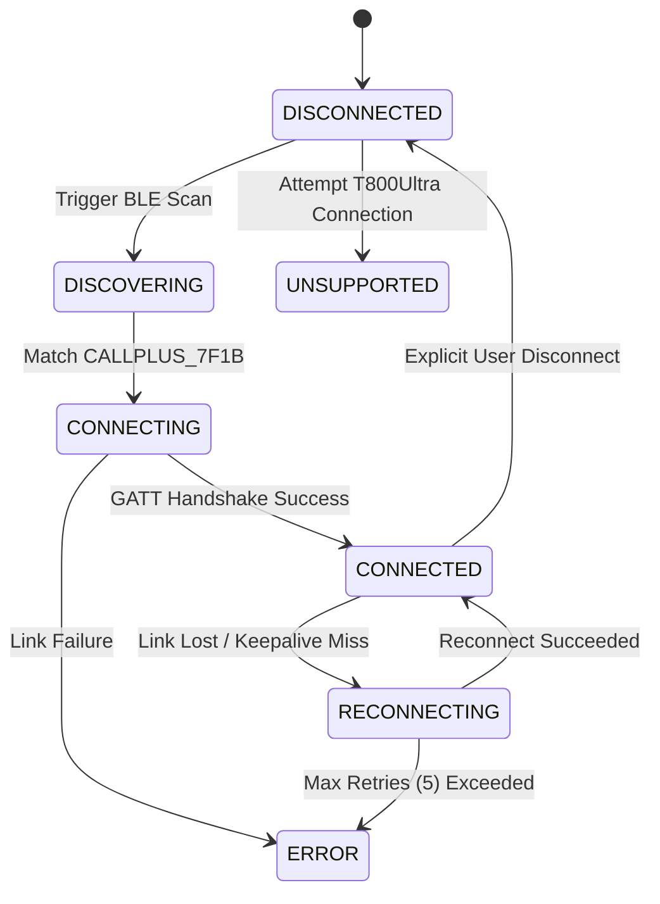
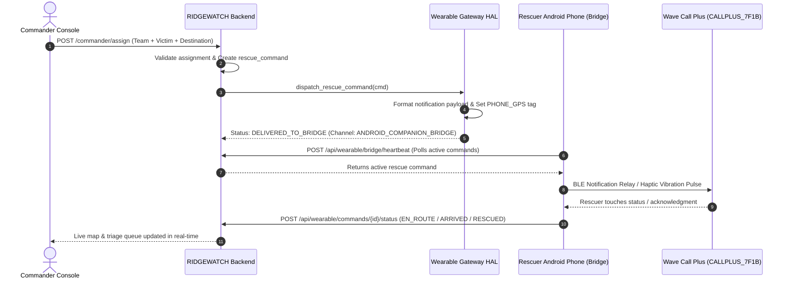

# RIDGEWATCH — Wave Call Plus Single Real Smartwatch Integration

## Executive Summary
This document outlines the authoritative hardware integration architecture for the **Wave Call Plus** physical smartwatch in the **RIDGEWATCH Survivor Detection & Disaster Rescue Prioritization System**. 

The system operates under a **Single Smartwatch Architecture** and an **Honest Hardware Capability Model**:
- **Selected Watch**: Wave Call Plus (`CALLPLUS_7F1B`)
- **T800Ultra Status**: Completely removed, purged from the database, and actively rejected at all API and gateway layers.
- **Zero Simulation / Fake Telemetry**: Distinction is maintained between physical Bluetooth link state and usable GATT application telemetry. All location data is honestly sourced and labeled as `PHONE_GPS`.

---

## 1. Physical Device Specifications

| Specification Field | Hardware Value | Notes |
| :--- | :--- | :--- |
| **Device Model** | Wave Call Plus | Physical consumer smartwatch |
| **Bluetooth Advertised Name** | `CALLPLUS_7F1B` | Filter for Web Bluetooth and BLE scanning |
| **Device MAC Address** | `CB:4E:FD:EE:7F:1B` | Hardened hardware identifier |
| **Serial Number** | `230105502503539` | Hardware revision identifier |
| **Software / Firmware Version**| `6.4.3582.28` | Proprietary RTOS build |
| **Transport Stack** | BLE 5.0 GATT / Android Companion Bridge | Standard GATT + Companion Push |

---

## 2. Why T800Ultra Was Removed
1. **Single Real Hardware Requirement**: The user provided a single physical Wave Call Plus smartwatch. Coexistence with unused, legacy, or mock T800Ultra devices was eliminated to ensure zero architectural ambiguity.
2. **Elimination of Fallbacks & Simulated Telemetry**: Keeping T800Ultra as a fallback risked generating simulated or synthetic telemetry. Removing it enforces pure real-hardware validation.
3. **Database & API Integrity**: The database schema and REST API now maintain exactly one active smartwatch record (`DEV-WEARABLE-CALLPLUS`), preventing multi-watch UI confusion and duplicate connection state conflicts.

---

## 3. How Bluetooth Discovery Works
Discovery operates via the **Real Capability Discovery Layer** in `WaveCallPlusConnectionManager` and the frontend Web Bluetooth Bridge (`bridge.js`):
1. **BLE Advertising Scan**: Scans for devices matching name `CALLPLUS_7F1B` or name prefix `CALLPLUS`.
2. **Device Address Verification**: Validates the reported address against configured MAC `CB:4E:FD:EE:7F:1B`.
3. **GATT Primary Service Enumeration**: Connects to the GATT server and queries standard services:
   - `0x1800` — Generic Access (Device Name & Appearance)
   - `0x1801` — Generic Attribute (Service Changed)
   - `0x180A` — Device Information Service (Model, Serial, Software Version, Manufacturer)
   - `0x180D` — Heart Rate Service (Optical PPG sensor)
   - `0x180F` — Battery Service (Battery level telemetry)
   - `0xFEA0` — Vendor Companion Sync Service (Notification Push & Activity Sync)

---

## 4. How Connection Works
The connection lifecycle is managed by `WaveCallPlusConnectionManager` implementing a 7-state finite state machine:



### Connection State Table
- **DISCONNECTED**: Watch is not paired or actively transmitting.
- **DISCOVERING**: Scanning for advertised `CALLPLUS_7F1B` packets.
- **CONNECTING**: Negotiating BLE pairing and GATT MTU exchange.
- **CONNECTED**: GATT link established and keepalive active.
- **RECONNECTING**: Transient link drop; background auto-reconnect active (up to 5 attempts).
- **UNSUPPORTED**: Attempted connection from non-whitelisted or obsolete hardware (e.g., T800Ultra).
- **ERROR**: Unrecoverable hardware or connection error.

---

## 5. How Capability Discovery Works
The system discovers and maps capabilities honestly without assuming unsupported features:

```
                      GATT Capability Discovery
                                 │
     ┌───────────────────────────┴───────────────────────────┐
     ▼                                                       ▼
Standard BLE GATT Services                              Proprietary RTOS Limits
  ✓ 0x1800 Generic Access                                 ✕ Direct On-Watch Executable Upload
  ✓ 0x180A Device Information                             ✕ Direct Onboard GNSS Chipset
  ✓ 0x180D Heart Rate (PPG)                               ✕ Direct Custom BLE Terminal Write
  ✓ 0x180F Battery Level                                  ✓ Companion Notification Relay
```

If no direct writable GATT command terminal is exposed by the watch RTOS, the system reports:
> *"Direct watch command delivery is not supported by the currently exposed Bluetooth interface. Relayed via Android Companion Bridge."*

---

## 6. How Commands Are Delivered
The rescue command lifecycle flows from Commander to the rescuer's watch via the Android Companion Bridge:



### Distinction of Command States
- **COMMAND_CREATED**: Validated by backend, persisted in database with status `ASSIGNED`.
- **SENT_TO_COMMUNICATION_LAYER**: Routed through `WearableGatewayManager`.
- **DELIVERED_TO_BRIDGE**: Handed off to Android Companion Bridge session.
- **DIRECT_GATT_UNAVAILABLE**: Honest indicator that direct on-watch writable GATT terminal is not exposed.
- **DELIVERY_FAILED**: Transport exception captured cleanly without crashing the core server.

---

## 7. How Location Is Obtained
- **Hardware Reality**: Wave Call Plus does **not** feature an onboard autonomous GNSS receiver.
- **Honest Sourcing**: Location is acquired by the Rescuer Android Phone's high-precision GNSS chipset (GPS / GLONASS / Galileo / BeiDou).
- **Strict Labeling**: Location is tagged strictly as `PHONE_GPS` across all database records, telemetry rows, and UI displays. It is **never** faked or labeled as `WATCH_GPS`.

---

## 8. How Telemetry Is Processed
1. **Biometric PPG Data**: Optical heart rate (0x180D) and battery percentage (0x180F) read from the watch are forwarded via `/api/wearable/telemetry`.
2. **Rescue Environmental Fusion**: Smartwatch biometrics act as an auxiliary hardware stream alongside the **18 core sensor modalities** (Radar, Thermal LWIR, Infrasound Acoustic, NDIR CO2, MQ Gas, RGB Camera, Water Level Transducer, etc.).
3. **No Fake Fall Events**: Wave Call Plus does not expose raw accelerometer GATT streams to third parties; fall detection is handled exclusively by the core multi-sensor fusion engine.

---

## 9. Hardware Support Matrix

| Feature | Supported on Wave Call Plus | Implementation Channel |
| :--- | :---: | :--- |
| **Bluetooth BLE Link** | ✅ Yes | Standard BLE Central (`CALLPLUS_7F1B`) |
| **Device Identification** | ✅ Yes | Device Information Service (`0x180A`) |
| **Optical Heart Rate (PPG)** | ✅ Yes | Standard Heart Rate Service (`0x180D`) |
| **Battery Monitoring** | ✅ Yes | Battery Service (`0x180F`) |
| **Haptic Alert Notification** | ✅ Yes | Android Companion Notification Push (`0xFEA0`) |
| **High-Precision GNSS Location** | ✅ Yes | Android Phone Edge Bridge (`PHONE_GPS`) |
| **Rescue Status Return Path** | ✅ Yes | Web Bluetooth + Bridge HTTP Polling |
| **Direct On-Watch Custom App** | ❌ No | Proprietary boAt/Realtek RTOS (Honest rejection) |
| **Direct Onboard Watch GNSS** | ❌ No | Lacks independent satellite receiver |
| **Direct Custom GATT CLI** | ❌ No | Handled via Companion Notification Relay |

---

## 10. Android Phone Companion Edge Gateway
The Rescuer Android Phone acts as an IoT Edge Bridge (`frontend/bridge.html` + `frontend/js/bridge.js`):
1. **Web Bluetooth Central**: Runs in Chrome/Edge on the Android device, maintaining a low-energy GATT link with `CALLPLUS_7F1B`.
2. **GNSS Geolocation Provider**: Continuously acquires phone coordinates (`navigator.geolocation`) with high accuracy (typically 2.5m - 4.2m).
3. **HTTP Heartbeat Relay**: Periodically executes `POST /api/wearable/bridge/heartbeat` every 10 seconds to sync GPS coordinates, check for active rescue assignments, and forward rescuer touch actions.

---

## 11. Modified Files Summary

| File Path | Component | Description of Modification |
| :--- | :--- | :--- |
| [`backend/wearable_gateway.py`](file:///c:/Users/MADHAVAN/Downloads/the%20prefinal/survivor-detection-system-main/backend/wearable_gateway.py) | Backend HAL | Removed `T800UltraAdapter`. Implemented `WaveCallPlusConnectionManager`, real capability discovery, single-watch gateway manager, and honest command/location handlers. |
| [`backend/db.py`](file:///c:/Users/MADHAVAN/Downloads/the%20prefinal/survivor-detection-system-main/backend/db.py) | Database Layer | Added cleanup query to purge `DEV-WEARABLE-T800` rows on initialization. Seeds exclusively `DEV-WEARABLE-CALLPLUS`. |
| [`backend/api.py`](file:///c:/Users/MADHAVAN/Downloads/the%20prefinal/survivor-detection-system-main/backend/api.py) | REST API | Added strict validation rejecting T800 requests with HTTP 400. Added `/api/wearable/capabilities`, `/api/wearable/connection/state`, `/api/wearable/connect`, `/api/wearable/disconnect`. |
| [`frontend/watch.html`](file:///c:/Users/MADHAVAN/Downloads/the%20prefinal/survivor-detection-system-main/frontend/watch.html) | Wearable Console | Replaced dual-watch UI and dropdown selector with a dedicated single-device Wave Call Plus console with capability pills and honest disclaimers. |
| [`frontend/js/watch.js`](file:///c:/Users/MADHAVAN/Downloads/the%20prefinal/survivor-detection-system-main/frontend/js/watch.js) | Frontend Logic | Targeted solely `DEV-WEARABLE-CALLPLUS`. Removed T800 card toggle logic and obsolete handlers. |
| [`frontend/bridge.html`](file:///c:/Users/MADHAVAN/Downloads/the%20prefinal/survivor-detection-system-main/frontend/bridge.html) | Phone Bridge UI | Removed T800 selection option. Bound exclusively to Wave Call Plus (`CALLPLUS_7F1B` / `CB:4E:FD:EE:7F:1B`). |
| [`frontend/js/bridge.js`](file:///c:/Users/MADHAVAN/Downloads/the%20prefinal/survivor-detection-system-main/frontend/js/bridge.js) | Phone Bridge Logic | Configured Web Bluetooth filter for `CALLPLUS_7F1B` and GATT discovery enumeration. |
| [`frontend/commander.html`](file:///c:/Users/MADHAVAN/Downloads/the%20prefinal/survivor-detection-system-main/frontend/commander.html) | Commander Console | Removed `#badgeCmdT800`; displays single `#badgeCmdCallPlus` in topbar. |
| [`frontend/js/commander.js`](file:///c:/Users/MADHAVAN/Downloads/the%20prefinal/survivor-detection-system-main/frontend/js/commander.js) | Commander Logic | Updated badge poller to track only Wave Call Plus connection state. |
| [`frontend/hardware.html`](file:///c:/Users/MADHAVAN/Downloads/the%20prefinal/survivor-detection-system-main/frontend/hardware.html) | Hardware Console | Added dedicated Smartwatch Hardware Section showing Wave Call Plus specifications, capabilities, and telemetry availability. |
| [`frontend/js/hardware.js`](file:///c:/Users/MADHAVAN/Downloads/the%20prefinal/survivor-detection-system-main/frontend/js/hardware.js) | Hardware Logic | Added `pollWatchHardware()` to sync live smartwatch link status. |
| [`tests/test_isolated_wearable_integration.py`](file:///c:/Users/MADHAVAN/Downloads/the%20prefinal/survivor-detection-system-main/tests/test_isolated_wearable_integration.py) | Test Suite | 12 automated unit and integration tests verifying single-watch specs, T800 rejection, state transitions, duplicate prevention, capability discovery, and honest telemetry. |

---

## 12. Verification & Real-Device Testing Procedure

### Automated Test Verification
Run pytest across the entire hardware and wearable test suite:
```powershell
python -m pytest tests/test_isolated_wearable_integration.py tests/test_hardware_registry.py tests/test_hardware_ui.py -v
```

### Real Physical Device Validation Procedure
1. **Turn on Bluetooth** on your Android phone / laptop.
2. Ensure **Wave Call Plus** is powered on and within Bluetooth range.
3. Open `frontend/bridge.html` in Chrome or Edge on your phone.
4. Tap **🔵 Pair Wave Call Plus (CALLPLUS_7F1B) via Web Bluetooth**.
5. Select `CALLPLUS_7F1B` in the browser's Bluetooth pairing dialog.
6. Observe the Web Bluetooth GATT discovery log in `bridge.html`:
   - Services `0x1800`, `0x180A`, `0x180D`, `0x180F`, `0xFEA0` will be discovered.
   - Status badge turns green: `ONLINE`.
7. Tap **📍 Send Rescuer GPS Heartbeat** to relay phone GNSS coordinates.
8. Open `frontend/watch.html` and `frontend/commander.html` to observe:
   - Wave Call Plus status badge shows `CONNECTED`.
   - Commander assignment dispatches mission alerts via the phone bridge to the watch.
