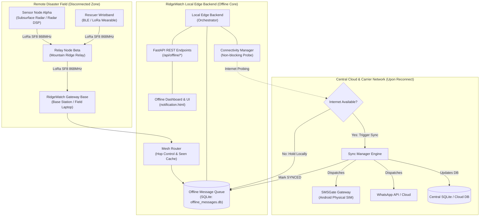

# RidgeWatch Resilient Offline Emergency Communication Architecture

## 1. Executive Summary

In disaster-stricken alpine and wilderness environments (such as Solang Pass, Himalayas), commercial cellular towers, fiber backhauls, and standard Internet access are frequently severed due to avalanches, landslides, flash floods, or seismic shock. 

The **RidgeWatch Offline Communication Subsystem** guarantees that life-critical survivor detections, medical emergencies, and hazard alarms continue to generate, persist locally, propagate across remote terrain via Sub-GHz LoRa mesh networks, and automatically synchronize to central cloud systems once Internet or satellite links return.

---

## 2. Core Architectural Principles

1. **100% Offline Autonomy**:
   - Every emergency alert generated by local DSP, radar, seismic sensors, or wearable telemetry is accepted, cryptographically hashed with CRC32/SHA-256 integrity checksums, and stored in a thread-safe local SQLite queue.
   - The edge base station operates completely independently without requiring an active Internet connection.
2. **Honest Hardware Abstraction**:
   - Regular SMS (via SMSGate/Android SIM) and WhatsApp cloud APIs strictly require a connected external telecommunications network.
   - During blackouts, SMS/WhatsApp dispatches are held locally in `PENDING` status. No fake SMS delivery is ever claimed.
   - LoRa operation defaults to an explicit **Simulator Mode** on standard laptop development environments, with physical UART/Serial HAL hooks ready for ESP32 / SX1262 transceiver modules.
3. **Multi-Hop Mesh Propagation**:
   - Intermediate relays forward packets across mountain ridges using hop counts and max hop constraints.
   - Seen-packet cache and CRC32 verification prevent routing loops and network packet storms.
4. **Idempotent Cloud Synchronization**:
   - When Internet connectivity is detected via non-blocking TCP socket probes, the synchronization worker dequeues alerts in strict order of priority (`CRITICAL` > `HIGH` > `MEDIUM` > `LOW`) and timestamp.
   - Messages are marked `SYNCED` only after successful external dispatch, preventing duplicate carrier SMS spam.

---

## 3. Architecture & Data Flow Diagram



---

## 4. Message Model Specification

Every offline emergency message follows the canonical `OfflineMessage` schema:

| Field | Type | Description |
| :--- | :--- | :--- |
| `message_id` | `TEXT (PK)` | Unique identifier format: `OFF-YYYYMMDDHHMMSS-<UUID8>` |
| `alert_id` | `TEXT (Nullable)` | Optional upstream survivor/disaster alert reference ID |
| `source_device_id` | `TEXT` | Originating field sensor node or wearable ID |
| `destination_device_id` | `TEXT` | Destination gateway ID or `BROADCAST` |
| `message_type` | `TEXT` | `SURVIVOR_DETECTED`, `MEDICAL_EMERGENCY`, `EARTHQUAKE_ALERT`, `FLOOD_ALERT`, `LANDSLIDE_ALERT`, `AVALANCHE_ALERT`, `RESCUE_ACK`, `GATEWAY_SYNC` |
| `payload_json` | `TEXT` | Serialized JSON payload containing survivor vitals, coordinates, SPS, etc. |
| `priority` | `TEXT` | `CRITICAL` (weight 0), `HIGH` (weight 1), `MEDIUM` (weight 2), `LOW` (weight 3) |
| `created_at` | `TEXT` | UTC ISO-8601 creation timestamp |
| `expires_at` | `TEXT` | UTC ISO-8601 expiration timestamp (TTL: default 24 hours) |
| `hop_count` | `INTEGER` | Current hop counter incremented by intermediate mesh relays |
| `max_hops` | `INTEGER` | Maximum allowable hops before packet termination (default: 5) |
| `status` | `TEXT` | `PENDING`, `TRANSMITTING`, `SENT`, `RECEIVED`, `ACKNOWLEDGED`, `SYNCED`, `FAILED`, `EXPIRED` |
| `retry_count` | `INTEGER` | Number of failed dispatch attempts |
| `last_error` | `TEXT` | Diagnostic error string from last failure |
| `checksum` | `TEXT` | CRC32 / SHA-256 hex string validating payload integrity |
| `last_attempt_at` | `TEXT` | UTC ISO-8601 timestamp of last transmission or sync attempt |

---

## 5. LoRa RF Propagation Modeling & Hardware Integration

### Simulator Mode (Default)
When physical transceivers are absent, the gateway simulates RF propagation using the **Log-Distance Path Loss Model**:
$$PL(d) = PL(d_0) + 10 \cdot n \cdot \log_{10}\left(\frac{d}{d_0}\right)$$
- Frequency: 868.0 MHz (configurable to 865.0 MHz for India or 915.0 MHz for US)
- Path Loss Exponent ($n$): 2.8 (Mountainous / Suburban terrain)
- Receiver Sensitivity Floor: -135 dBm (SX1262 standard)
- Time-on-Air (ToA) is modeled per Semtech SF8 / 125 kHz BW / 4/5 Coding Rate formulas (~108 ms per packet).

### Physical Hardware Mode
To activate physical LoRa transceiver hardware:
1. Connect an ESP32 / SX1262 USB UART transceiver to the edge device (e.g. `COM3` on Windows, `/dev/ttyUSB0` on Linux).
2. Set `.env` parameters:
   ```env
   LORA_MODE=hardware
   LORA_SERIAL_PORT=COM3
   LORA_BAUD_RATE=115200
   LORA_FREQUENCY_MHZ=868.0
   ```
3. The gateway starts a non-blocking background serial listener thread with frame delimiters and CRC integrity verification.

---

## 6. Multi-Hop Mesh Routing & Loop Suppression

- **Forwarding Decision Tree**:
  1. Check incoming packet against `_seen_packets` memory cache. If seen within TTL window, drop as `DROPPED_DUPLICATE`.
  2. If `destination_id` matches local node or `BROADCAST`, process locally and trigger local delivery callback.
  3. If packet is `RESCUE_ACK`, update local queue status to `ACKNOWLEDGED`.
  4. Increment `hop_count`. If `hop_count > max_hops`, drop as `DROPPED_TTL_EXPIRED`.
  5. Resolve next hop from routing table. If unknown, flood via `BROADCAST`.
  6. Transmit frame over LoRa gateway and record forwarding log.

---

## 7. Internet Connectivity & Cloud Synchronization

- **Non-blocking Detection**:
  - `ConnectivityManager` probes fast DNS/HTTP ports (8.8.8.8:53, 1.1.1.1:53) with a short 1.5s timeout.
  - Results are cached for 10 seconds to ensure emergency alert processing in edge threads is never blocked.
- **Deduplication Engine**:
  - `SyncManager` tracks in-memory and database sync state.
  - Pending messages are dispatched to SMSGate/WhatsApp only once upon connectivity restoration.
  - If external SMSGate dispatch succeeds, status transitions to `SYNCED`.
  - If dispatch fails, retry counter is incremented and status is set to `FAILED` for automatic retry on the next sync interval.

---

## 8. REST API Interface

| Endpoint | Method | Description |
| :--- | :--- | :--- |
| `/api/offline/status` | `GET` | Health metrics, online state, queue sizes, active LoRa mode |
| `/api/offline/queue` | `GET` | Message records list with optional `?status=PENDING&limit=50` |
| `/api/offline/enqueue` | `POST` | Ingests a new emergency alert into the offline pipeline |
| `/api/offline/sync` | `POST` | Triggers immediate synchronization of pending messages |
| `/api/offline/simulator/send` | `POST` | Injects a simulated LoRa RF packet across mesh nodes |
| `/api/offline/nodes` | `GET` | Returns list of registered LoRa nodes and routing table |

---

## 9. Verification & Testing

### Run Offline Test Suite
```bash
python -m pytest tests/test_offline_communication.py -v
```

### Run End-to-End Mesh Simulation Demo
```bash
python scripts/test_offline_communication.py
```

### Run Full Repository Regression Suite
```bash
python -m pytest
```
