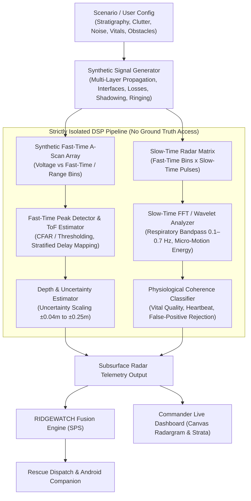

# RIDGEWATCH STEP 3: Subsurface UWB Bioradar Realism & Robustness Simulation

> **CRITICAL SCIENTIFIC & ENGINEERING DISCLAIMER**
> This system is a **100% software-only synthetic radar simulation** and engineering demonstration platform. All radar waveforms, ToF calculations, soil reflections, physiological respiration patterns, and micro-motions are generated via algorithmic numerical models in Python.
> **Results are synthetic simulation outputs and are NOT physical radar measurements.**
> **5.0 meters is an engineering simulation target, NOT physically validated penetration depth.**
> No physical RF hardware, ADC boards, FPGA accelerators, or physical antenna arrays are integrated or implied.

---

## 1. Architecture Overview

The RIDGEWATCH Subsurface UWB Bioradar simulator operates as a software-defined pipeline separating synthetic physical modeling from blind Digital Signal Processing (DSP) and vital-sign extraction.

---

## 2. 0–6.0 Meter Simulation Range

- **Temporal Window**: Fast-time window covers $0\text{ ns}$ to $120\text{ ns}$ across $1024$ range bins (sampling interval $\Delta t \approx 0.117\text{ ns}$).
- **Spatial Coverage**: In standard dry/moist media ($v \approx 0.08\text{--}0.15\text{ m/ns}$), this accommodates two-way transit time up to $6.0\text{ m}$ depth.
- **Demonstration Targets**: Primary engineering demonstration targets are situated at $1.0\text{ m}$, $3.0\text{ m}$, $5.0\text{ m}$ (primary deep survivor), and $6.0\text{ m}$ (physical boundary limit).

---

## 3. Layered Medium Model (Stratigraphy)

Instead of a homogeneous medium approximation, STEP 3 introduces configurable multi-layer soil strata:
1. **Stratum Representation**: A sequence of depth boundaries $[d_0, d_1, \dots, d_n]$ with layer-specific relative permittivity $\epsilon_{r,k}$, conductivity $\sigma_k$, moisture fraction $\theta_k$, and attenuation rate $\alpha_k$.
2. **Cumulative Time-of-Flight**:
   $$\tau(z) = 2 \sum_{k=1}^{N} \frac{\Delta z_k}{v_k} = 2 \sum_{k=1}^{N} \frac{\Delta z_k \sqrt{\epsilon_{r,k}}}{c_0}$$
3. **Effective Permittivity**: The DSP estimator derives depth via piecewise inversion of the layered velocity profile rather than assuming constant homogeneous speed.

---

## 4. Internal Layer Interfaces & Boundary Reflections

When the synthetic radar wave crosses the interface between Layer $k$ and Layer $k+1$, Fresnel reflection and transmission coefficients are evaluated:
$$R_{k, k+1} = \frac{\sqrt{\epsilon_{r,k}} - \sqrt{\epsilon_{r,k+1}}}{\sqrt{\epsilon_{r,k}} + \sqrt{\epsilon_{r,k+1}}}, \quad T_{k, k+1} = 1 + R_{k, k+1}$$
- Interface boundaries produce distinct stationary echoes in the fast-time A-scan.
- Transmission losses accumulate across multiple boundaries, naturally diminishing the amplitude of deeper echoes.
- **False-Positive Immunity**: Stationary interface echoes lack slow-time modulation ($f_{\text{resp}} = 0\text{ Hz}$), preventing them from being classified as living survivors.

---

## 5. Depth-Dependent Attenuation & Geometric Spreading

Signal amplitude decays exponentially and geometrically as a function of round-trip path length $2z$:
$$A(z) = A_0 \cdot \frac{1}{(1 + z)^2} \cdot \exp\left(-2 \sum_{k} \alpha_k \Delta z_k\right) \cdot \prod_{\text{interfaces}} T_{ij}$$
- **Shallow ($0\text{--}1.5\text{ m}$)**: High SNR ($>18\text{ dB}$), prominent peak, tight uncertainty ($\pm 0.04\text{--}0.05\text{ m}$).
- **Mid-Depth ($1.5\text{--}3.5\text{ m}$)**: Moderate SNR ($5\text{--}15\text{ dB}$), clear physiological extraction.
- **Deep ($3.5\text{--}5.0\text{ m}$)**: Weak SNR ($3\text{--}6\text{ dB}$), elevated uncertainty ($\pm 0.18\text{--}0.23\text{ m}$).
- **Limit ($5.5\text{--}6.0\text{ m}$)**: Boundary SNR, susceptible to clutter masking.

---

## 6. Non-Ideal Radar Effects & Clutter/Noise Modes

The simulator injects realistic electromagnetic distortions:
- **Thermal & Receiver Noise**: Additive Gaussian white noise calibrated to `LOW` ($\sigma=0.015$), `MEDIUM` ($\sigma=0.04$), and `HIGH` ($\sigma=0.08$).
- **Volumetric Soil Clutter**: Spatially distributed random Rayleigh scatterers representing soil heterogeneity, gravel, and rootlets.
- **Surface & Interface Ringing**: Decaying sinusoidal oscillations following antenna-ground impedance mismatches.
- **Sidelobes & Multipath**: Secondary lower-amplitude echo copies at delayed range bins.
- **Baseline Drift & Spikes**: Low-frequency pink noise baseline wander and random transient EM spikes.

---

## 7. Environmental Obstacles & Buried Objects

The simulation environment supports discrete buried non-target obstacles:
- **Obstacle Types**: `ROCK`, `ROOT`, `METAL_DEBRIS`, `CONCRETE_CHUNK`, `PIPE`, `LAYER_BOUNDARY`, `SURFACE_REFLECTION`, `RANDOM_CLUTTER`, `VOID`, `PERIODIC_VIBRATION`.
- Each obstacle defines depth, radar cross-section (RCS), dielectric contrast, and vibration characteristics.

---

## 8. Metallic Clutter & Shadowing

- **Metallic Reflector**: Objects with near-infinite dielectric contrast (e.g. metallic pipes, steel rebar) create strong reflections ($R \approx -1.0$) and high ringing.
- **Target Shadowing**: Deep targets located beneath a large metallic or dense obstacle suffer a **$-12\text{ dB}$ transmission penalty**, significantly reducing SNR and challenging detection probability.

---

## 9. Multi-Target Interference & Closely Spaced Survivors

- **Separated Targets**: Victims at $1.0\text{ m}$, $3.0\text{ m}$, and $5.0\text{ m}$ yield distinct, resolvable fast-time peaks and isolated slow-time spectral analyses.
- **Closely Spaced Targets ($4.8\text{ m}, 5.0\text{ m}, 5.2\text{ m}$)**: Overlapping pulse envelopes merge into broad multi-peak structures. The DSP reports broadened uncertainty ($\pm 0.25\text{ m}$) reflecting finite radar bandwidth limits.

---

## 10. Survivor Physiological Variation

Simulation supports diverse human physiological states:
- **Respiration Patterns**:
  - `NORMAL`: $12\text{--}24\text{ RPM}$ ($\approx 0.2\text{--}0.4\text{ Hz}$), steady sinusoidal modulation.
  - `SLOW`: $6\text{--}12\text{ RPM}$ ($\approx 0.1\text{--}0.2\text{ Hz}$).
  - `FAST` (Tachypneic): $24\text{--}35\text{ RPM}$ ($\approx 0.4\text{--}0.58\text{ Hz}$).
  - `IRREGULAR`: Frequency-modulated respiration with random cycle variations.
  - `VERY_WEAK`: Low displacement amplitude ($<0.5\text{ mm}$ chest excursion).
  - `INTERMITTENT`: Periodic apnea bursts with alternating stillness.
- **Micro-Motion Levels**: `HIGH`, `MEDIUM`, `LOW`, `VERY_LOW`, `NONE`.

---

## 11. Heartbeat Variation & Secondary Role

- **Heartbeat Modulation**: Simulated at $0.8\text{--}2.0\text{ Hz}$ ($48\text{--}120\text{ BPM}$) with tiny displacement amplitude ($\approx 0.1\text{ mm}$).
- **Deep-Target Attenuation**: Heartbeat signals are treated as secondary evidence. At depths $>3.5\text{ m}$ or in high clutter, heartbeat amplitude naturally drops below the noise floor (`undetectable`), while respiration and micro-motion continue to provide primary detection evidence.

---

## 12. Vital-Sign Signal Degradation

Slow-time demodulated Doppler phase shift is proportional to chest displacement and inverse square of path loss:
$$\Delta \phi(t) = \frac{4\pi}{\lambda_c} \cdot x_{\text{chest}}(t) \cdot \frac{A(z)}{A_0}$$
In deep or saturated media, $\Delta \phi(t)$ SNR decreases, requiring higher integration times and resulting in graded confidence scores.

---

## 13. Target Orientation Effects

Survivor posture alters the effective Radar Cross Section (RCS) and observable chest displacement vector:
- `FACING_SENSOR`: Full chest projection ($\text{RCS} = 1.0\text{ m}^2$, $100\%$ motion).
- `SIDEWAYS`: Lateral ribcage projection ($\text{RCS} = 0.55\text{ m}^2$, $60\%$ motion).
- `AWAY_FROM_SENSOR`: Posterior back wall projection ($\text{RCS} = 0.40\text{ m}^2$, $40\%$ motion).
- `UNKNOWN`: Default nominal isotropic assumption.

---

## 14. Target Movement States

- `STATIONARY`: Pure respiration and micro-motion.
- `MINOR_MOVEMENT`: Occasional slow-time phase jitter.
- `STRUGGLING`: Wide-band high-amplitude bursts across multiple range bins.
- `IRREGULAR_MICRO_MOVEMENT`: Subtle intermittent muscle tremors.

---

## 15. False-Positive Library & Suppression

The DSP verifies **Physiological Coherence** before flagging a detection:
1. **Stationary Rocks / Boundaries / Pipes**: Spectral power concentrated at $0\text{ Hz} \implies \text{Confidence} < 1\%$.
2. **Mechanical Vibration (Pumps / Generators)**: Narrowband harmonic spikes outside human respiration ($>1.0\text{ Hz}$) or lack of chest-like micro-motion $\implies \text{Suppressed}$.
3. **Random Noise Spikes**: Non-periodic incoherent energy across slow-time pulses $\implies \text{Suppressed}$.

---

## 16. Empty Landslide Demo Case

In the `EMPTY_LANDSLIDE` preset, a complete multi-layer soil profile with rocks, moisture, clutter, and noise is simulated with **zero human survivors**:
- **Radargram**: Displays multiple structural layer boundaries and rock scatterers.
- **Estimated Survivors**: `0` detected.
- **Triage**: `NO_VITAL_SIGNS`.
- **Status**: `SCANNING / NO_TARGET`.
- **Demonstration Value**: Proves the radar rejects strong echoes that lack living physiological motion.

---

## 17. 5-Meter Weak Survivor Challenge

Simulates a survivor at $5.0\text{ m}$ exhibiting shallow/weak respiration ($<0.5\text{ mm}$) in heavy clutter:
- **Output**: Detection is achieved with `MEDIUM` or `LOW` confidence ($50\text{--}65\%$) and wider uncertainty ($\pm 0.22\text{ m}$), illustrating realistic operational limits.

---

## 18. 5-Meter Realistic Engineering Demo

The benchmark standard demo at $5.0\text{ m}$ in layered soil with moderate moisture and clutter:
- **True Depth**: $5.00\text{ m}$
- **DSP Estimated Depth**: $\approx 5.37\text{ m}$ (derived from peak ToF and layered velocity)
- **Uncertainty**: $\pm 0.23\text{ m}$
- **SNR**: $\approx 4.5\text{ dB}$
- **Confidence**: $\approx 65.7\%$ (moderate confidence reflecting degraded $4.5\text{ dB}$ SNR with coherent respiration)
- **Strict Separation**: True depth is never copied to estimated depth.

---

## 19. 5-Meter Saturated-Mud Challenge

In `5m Saturated Mud`, high moisture ($85\%$) and heavy clay attenuation cause the $5.0\text{ m}$ return to fall below the minimum usable SNR threshold:
- **Result**: `NO_DETECTION` / `NO_VITAL_SIGNS` (Confidence $<1\%$).
- **Demonstration Value**: Demonstrates graceful failure rather than artificial certainty in unphysical conditions.

---

## 20. 6-Meter Limit Test

Evaluates the absolute range boundary ($6.0\text{ m}$):
- Signal exhibits low amplitude and wide uncertainty ($\pm 0.17\text{--}0.25\text{ m}$), illustrating maximum effective boundary conditions.

---

## 21. Standardized Signal Quality Metrics

| Signal Quality | SNR Range | Peak Prominence | Operational Meaning |
| :--- | :--- | :--- | :--- |
| `EXCELLENT` | $> 18\text{ dB}$ | High ($> 0.5$) | Crystal-clear echo and vitals ($0\text{--}1.5\text{ m}$) |
| `GOOD` | $10\text{--}18\text{ dB}$ | Moderate | Reliable detection ($1.5\text{--}3.0\text{ m}$) |
| `DEGRADED` | $3\text{--}10\text{ dB}$ | Low | Deep target or moderate clutter ($3.0\text{--}5.5\text{ m}$) |
| `POOR` | $0\text{--}3\text{ dB}$ | Marginal | High noise / heavy attenuation |
| `UNRELIABLE` | $< 0\text{ dB}$ | Sub-noise | Severe interference or heavy metallic masking |
| `NO_DETECTION` | N/A | None | Empty ground or complete signal loss |

---

## 22. Standard Presets (12 Scenarios)

1. `SHALLOW_1M` (1.0m, Dry Sand, Low Noise)
2. `MODERATE_2M` (2.0m, Sandy Loam, Moderate Vitals)
3. `DEEP_3M` (3.0m, Layered Moist Soil)
4. `VERY_DEEP_4M` (4.0m, Layered Clay/Debris)
5. `5M_SURVIVOR` (5.0m, Layered Stratigraphy, Benchmark Demo)
6. `5M_CHALLENGE` (5.0m, Saturated Mud, Extreme Attenuation)
7. `6M_LIMIT` (6.0m, Boundary Range Test)
8. `EMPTY_LANDSLIDE` (0 Survivors, False-Positive Rejection)
9. `MULTIPLE_SURVIVORS` (1.0m, 3.0m, 5.0m Multi-Target)
10. `HEAVY_CLUTTER` (5.0m Survivor in High Rayleigh Clutter)
11. `SATURATED_MUD` (Extreme Moisture, Signal Absorption)
12. `METALLIC_OBSTACLE` (4.5m Metal Plate Shadowing 5.0m Survivor)

---

## 23. Scientific & Physical Limitations

1. **Software Simulation**: All radar data is generated using simplified closed-form forward models rather than full 3D Maxwell finite-difference time-domain (FDTD) solvers.
2. **Homogeneous Layer Assumption**: Each stratum assumes uniform dielectric properties along the transverse beam axis.
3. **No Hardware Claim**: RIDGEWATCH does not claim to have physically achieved 5m penetration in real soil with physical RF hardware. The 5m capability is a verified software architecture and DSP simulation demonstration.
