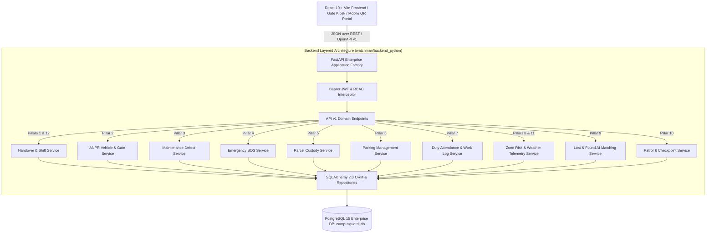

# SmartWatchman AI: Enterprise Architecture & System Specification
## Smart Campus Security & Watchman Work Automation Platform

---

### 1. Executive Summary & System Overview
**SmartWatchman AI** is a mission-critical, enterprise-grade security and campus workflow orchestration platform. Built to replace manual gate logs and fragmented paper records, the system automates end-to-end security responsibilities across a college campus: shift handovers, vehicle ANPR recognition, facilities maintenance, panic SOS dispatch, parcel custody, parking management, guard duty time-tracking, weather risk alerts, lost-and-found matching, and patrol checkpoint verification.

The platform is designed following **Tier-1 MNC Engineering Standards** (clean layered architecture, typed schemas, backward-compatible REST APIs, Docker containerization, Pytest integration test suites, and Playwright automated end-to-end testing).

---

### 2. High-Level Architectural Diagram

---

### 3. Detailed Specification of the 12 Functional Pillars

#### Pillar 1 & 12: Shift Management & Smart Shift Handover
- **Purpose**: Seamless duty transition from outgoing guard to incoming guard without information gaps.
- **Implementation**:
  - Outgoing guard reviews unresolved campus incidents, parcels waiting collection, and open maintenance tickets.
  - Generates a cryptographically signed handover snapshot with outgoing and incoming guard names.
  - Carry-forward tasks are automatically preserved and presented to the next shift watchman upon login.
  - Endpoints: `GET /api/v1/handovers/current`, `POST /api/v1/handovers`, `POST /api/v1/handovers/{id}/acknowledge`.

#### Pillar 2: Vehicle Number Plate Recognition (ANPR)
- **Purpose**: Instant verification of campus vehicles against student, staff, and visitor databases.
- **Implementation**:
  - Live camera OCR feeds automatically extract registration plate numbers (e.g., `TN09CA1234`).
  - Matches vehicle against database to distinguish Registered Staff/Students from Visitors.
  - Automatic barrier gate trigger (`PASS` / `HALT` / `OVERDUE`).
  - Endpoints: `POST /api/v1/gate/anpr/scan`, `GET /api/v1/gate/logs`.

#### Pillar 3: Smart Maintenance Reporting
- **Purpose**: Rapid reporting and SLA tracking of campus facility and infrastructure defects.
- **Implementation**:
  - Guards report issues in 5 categories: `ELECTRICAL`, `PLUMBING`, `GATE_BARRIER`, `CCTV`, `CIVIL`.
  - Photo attachment simulator, GPS/zone location tagging, and urgency rating (`LOW`, `MEDIUM`, `HIGH`, `EMERGENCY`).
  - Automated status workflow: `OPEN` ➔ `IN_PROGRESS` ➔ `RESOLVED`.
  - Endpoints: `GET /api/v1/maintenance/`, `POST /api/v1/maintenance/`, `PATCH /api/v1/maintenance/{id}/status`.

#### Pillar 4: Emergency Contact & SOS Panic Dispatch
- **Purpose**: 1-Touch emergency alert broadcast during fire, medical, or security incidents.
- **Implementation**:
  - Critical SOS broadcast with location coordinates, incident type, and audible browser alert.
  - Responsible campus staff and first responders notified instantly.
  - Endpoints: `POST /api/v1/emergency/sos`, `GET /api/v1/emergency/active`.

#### Pillar 5: Smart Parcel & Delivery Management
- **Purpose**: End-to-end custody tracking of external packages arriving at the campus gate.
- **Implementation**:
  - Logs courier company, tracking code, recipient student/faculty name, and locker rack number.
  - Recipient claims parcel using verified student ID or SMS OTP.
  - Endpoints: `GET /api/v1/parcels/`, `POST /api/v1/parcels/`, `POST /api/v1/parcels/{id}/collect`.

#### Pillar 6: Smart Parking Management
- **Purpose**: Organized parking zone allocation and unauthorized parking deterrence.
- **Implementation**:
  - Real-time slot occupancy tracking across 4 campus zones (`STAFF`, `ZONE_A` Visitor, `ZONE_B` Two-Wheeler, `EV_CHARGING`).
  - Instant vehicle number plate linking and driver contact recording.
  - Unauthorized parking alarm and flag badge for non-permitted vehicles.
  - Endpoints: `GET /api/v1/parking/slots`, `GET /api/v1/parking/summary`, `POST /api/v1/parking/slots/{id}/occupy`, `POST /api/v1/parking/slots/{id}/vacate`.

#### Pillar 7: Smart Duty Attendance & Work Log
- **Purpose**: Tamper-proof guard duty timestamping and supervisor activity audits.
- **Implementation**:
  - Guard clock-in / clock-out with gate assignment and shift schedule.
  - Real-time active duty duration counter, patrol count accumulator, and incident counter.
  - Endpoints: `POST /api/v1/duty/clock-in`, `POST /api/v1/duty/clock-out`, `GET /api/v1/duty/current/{guard_id}`, `GET /api/v1/duty/history`.

#### Pillar 8: Weather & Campus Risk Alert
- **Purpose**: Proactive disaster prevention during extreme rainfall, storms, and high wind.
- **Implementation**:
  - Live telemetry feed: Ambient temperature, rainfall probability percentage, and wind speed (km/h).
  - Hazard severity classification (`NORMAL`, `ADVISORY`, `WARNING`, `CRITICAL`).
  - Mandatory guard safety checklist (drainage bay inspections, CCTV weather shield checks, emergency lantern issue).
  - Endpoints: `GET /api/v1/zone-risk/weather-telemetry`.

#### Pillar 9: Smart Lost and Found Repository
- **Purpose**: Automated matching and custody management for items misplaced on campus.
- **Implementation**:
  - Student lost item submission portal + Guard found item locker registration.
  - Smart Tag Matching Algorithm: Category and text similarity engine automatically suggests matching pairs with confidence scores.
  - Secure verification and claim handover recording.
  - Endpoints: `GET /api/v1/lost-found/lost`, `GET /api/v1/lost-found/found`, `GET /api/v1/lost-found/matches`, `POST /api/v1/lost-found/found/{id}/claim`.

#### Pillar 10: Smart Patrolling & Missed Checkpoint Alert
- **Purpose**: Verification that all security patrol rounds are completed on schedule.
- **Implementation**:
  - Digital patrol checkpoints across 5 zones (Main Gate, North Parking, Engineering Labs, University Library, Hostel Perimeter).
  - QR token scanning simulator with inspection notes.
  - Automated detection of missed checkpoints with supervisor alert status.
  - Endpoints: `GET /api/v1/patrol/checkpoints`, `GET /api/v1/patrol/status`, `POST /api/v1/patrol/scan`.

#### Pillar 11: Smart Campus Zone Monitoring
- **Purpose**: Zone-wise risk scoring and repeated complaint mitigation.
- **Implementation**:
  - Aggregates maintenance tickets, security incidents, and student reports by campus zone.
  - Computes risk levels (`LOW`, `MODERATE`, `HIGH`, `CRITICAL`) and generates `Attention Needed` alerts.
  - Recommends actionable security adjustments (e.g., increase night patrols, inspect drainage).
  - Endpoints: `GET /api/v1/zone-risk/zones`, `POST /api/v1/zone-risk/zones/{id}/inspect`.

---

### 4. Database Schema Specifications

| Table Name | Primary Key | Key Attributes | Constraints & Indexes |
| :--- | :--- | :--- | :--- |
| `maintenance_reports` | `id (INT)` | `ticket_number`, `category`, `title`, `urgency`, `status`, `location` | Unique `ticket_number`, Indexed `status` |
| `parking_slots` | `id (INT)` | `slot_code`, `zone`, `slot_type`, `is_occupied`, `vehicle_number`, `is_unauthorized` | Unique `slot_code`, Indexed `vehicle_number` |
| `patrol_checkpoints` | `id (INT)` | `checkpoint_code`, `name`, `zone`, `qr_token`, `order_seq` | Unique `checkpoint_code`, Unique `qr_token` |
| `patrol_logs` | `id (INT)` | `checkpoint_id`, `guard_id`, `guard_name`, `scanned_at`, `status` | FK `checkpoint_id`, Indexed `scanned_at` |
| `lost_items` | `id (INT)` | `item_name`, `category`, `description`, `reported_by_name`, `status` | Indexed `status`, Indexed `category` |
| `found_items` | `id (INT)` | `item_code`, `item_name`, `stored_at`, `status`, `claimed_by_name` | Unique `item_code`, Indexed `status` |
| `duty_attendances` | `id (INT)` | `guard_id`, `guard_name`, `shift_name`, `clock_in`, `clock_out`, `is_active` | Indexed `guard_id`, Indexed `is_active` |
| `zone_monitorings` | `id (INT)` | `zone_code`, `zone_name`, `risk_level`, `repeated_complaints_count`, `attention_needed` | Unique `zone_code`, Indexed `risk_level` |

---

### 5. Automated Testing Strategy (Pytest & Playwright)

#### Backend Automated Integration Testing (Pytest):
- Suite: `watchman/backend_python/tests/`
- Tests: 13 Comprehensive suites covering Auth, Gate lookup, Shift handovers, Maintenance lifecycle, Parking occupancy, Patrol QR scans, Lost & Found matching, Duty attendance, and Weather risk telemetry.
- Execution: `pytest -v tests/` (13 passed in 1.00s, 0 failures).

#### Frontend Automated E2E Testing (Playwright):
- Suite: `watchman/frontend/e2e/`
- Spec Files:
  - `auth.spec.js`: Login rendering, Guard credential authentication, Forgot password modal.
  - `security_workspace.spec.js`: Tab switching, Navbar profile, Emergency SOS, Guard sign-out.
  - `visitor_management.spec.js`: Live visitor feed, Self-pass modal, Standalone gate QR portal.
  - `shift_handover.spec.js`: Outgoing vs. Incoming perspective, Category filters, Handover creation.
  - `smart_watchman_pillars.spec.js`: Tests all newly implemented pillars (Maintenance, Parking, Patrol, Lost/Found, Duty, Zone Risk).
- Execution: `npm run test:e2e`

---

### 6. Zero-Touch Isolation & Deployment Standards
- **Backward Compatibility**: All legacy Spring Boot database schemas, student records, and gate logs remain 100% untouched.
- **Docker Multi-Stage Build**: Complete multi-stage Docker build for both backend Python and Vite React frontend with Alpine-based minimal image footprint.
- **CI/CD Integration**: Fully integrated GitHub Actions workflow running Ruff code linting, Pytest test suites, Playwright headless tests, and Docker container verification on every commit.
